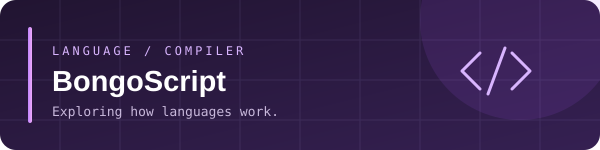

**CSE Student · Full-Stack Development · AI & Developer Tools**

---

<table>
<tr>
<td width="50%" valign="top">

## ✦ About

I'm **S.M. Toha**, a Computer Science & Engineering student at **Daffodil International University**. I enjoy turning ideas into practical software, exploring how systems work, and learning by building.

- ✧ Full-stack applications and AI-powered products
- ✧ Programming languages and developer tooling
- ✧ Clean implementation and continuous learning
- ✧ Open to collaboration on interesting projects

</td>
<td width="50%" valign="top">

## ⌘ My toolkit

**WEB & PRODUCT**

**LANGUAGES**

</td>
</tr>
</table>

## 01 — Featured builds

<table>
<tr>
<td width="50%" valign="top">

### ◈ BongoScript

A public programming-language / compiler project exploring language design and implementation.

**LANGUAGE DESIGN** · **COMPILER CONCEPTS**

[**Explore source ↗**](https://github.com/smtoha/bongoscript_project)

</td>
<td width="50%" valign="top">

### ◈ Study Buddy Hub

A public study-focused application project centered on learning workflows and student productivity.

**WEB APPLICATION** · **LEARNING TOOLS**

[**Explore source ↗**](https://github.com/smtoha/study-buddy-hub)

</td>
</tr>
</table>

## 02 — The commit snake

The snake animation is generated from your GitHub contribution calendar. The workflow refreshes it daily.

  

## 03 — GitHub activity

## 04 — How I build

**01 / EXPLORE**　✦　**02 / DESIGN**　✦　**03 / BUILD**　✦　**04 / REFINE**

Small iterations. Useful outcomes. Always learning.

---

### Have a thoughtful idea? Let's build it.

DESIGN → BUILD → LEARN → ITERATE

