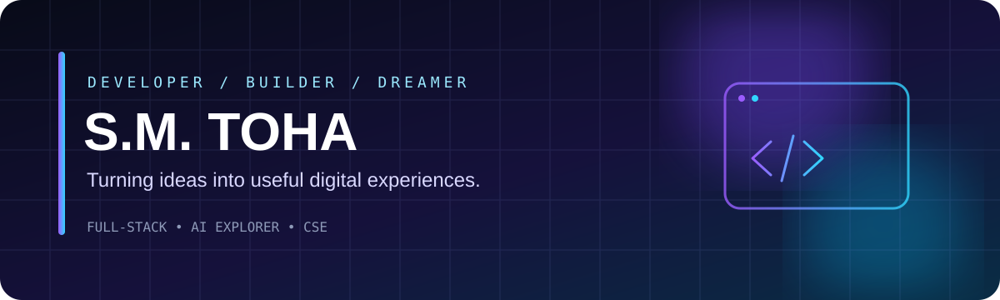

### Building thoughtful software, one idea at a time.

**CSE Student · Full-Stack Development · AI & Developer Tools**

---

## 01 — About

I'm **S.M. Toha**, a Computer Science & Engineering student at **Daffodil International University**. I enjoy turning ideas into practical software, exploring how systems work, and learning by building.

- ✦ Interested in full-stack applications, AI-powered products, and developer tools
- ✦ Enjoys experimenting with programming languages and product ideas
- ✦ Values clean implementation, continuous learning, and useful outcomes
- ✦ Open to collaborating on interesting projects

## 02 — Selected work

<table>
<tr>
<td width="50%" valign="top">

### ◈ BongoScript

A public programming-language / compiler project exploring language design and implementation.

**Focus:** programming languages · compiler concepts

[**Explore source ↗**](https://github.com/smtoha/bongoscript_project)

</td>
<td width="50%" valign="top">

### ◈ Study Buddy Hub

A public study-focused application project centered on learning workflows and student productivity.

**Focus:** web application · learning tools

[**Explore source ↗**](https://github.com/smtoha/study-buddy-hub)

</td>
</tr>
<tr>
<td width="50%" valign="top">

### ◈ More public repositories

Coursework, experiments, and other builds are collected in my public GitHub repositories.

[**Browse all repositories ↗**](https://github.com/smtoha?tab=repositories)

</td>
<td width="50%" valign="top">

### ◈ What I'm exploring

Full-stack development, AI-assisted experiences, and software that makes everyday workflows easier.

</td>
</tr>
</table>

## 03 — Tech stack

**WEB & PRODUCT**

**LANGUAGES**

## 04 — GitHub at a glance

---

### Have a thoughtful idea? Let's build it.

[GitHub](https://github.com/smtoha) &nbsp;·&nbsp; [LinkedIn](https://www.linkedin.com/in/s-m-toha-433007403/)

DESIGN → BUILD → LEARN → ITERATE

